# Oracle To Azure Database for PostgreSQL Rapid Migration POC

A configurable rapid POC for converting an Oracle schema to **Azure Database for PostgreSQL**,
deployed by a single **Deploy to Azure** button. Choose the complete environment or only the
components you need:

- a **Windows workstation** running desktop **Visual Studio Code + the Microsoft PostgreSQL
  extension** (the tool that performs the AI conversion),
- an **Oracle source database** (Oracle Database Free 23ai in a container) pre-seeded with a
  sample **HR** schema  so you can prove the tooling end to end with zero external dependencies,
- an **Azure Database for PostgreSQL flexible server** as the conversion target, and
- an **Azure OpenAI (Microsoft Foundry)** model deployment that powers the AI conversion.

Everything is network-isolated and reached privately over **Azure Bastion**. No custom
conversion logic runs here — the PostgreSQL extension does the work; this repo just stands
up the whole environment for you.

> **Scope: schema only, not data.** This POC converts and deploys the **schema** — tables,
> views, constraints, types, and other DDL objects. It does **not** copy table **rows** (the
> conversion only reads the Oracle source). The deployed PostgreSQL tables are empty until you
> load data with a separate tool such as **Azure Database Migration Service**, **`ora2pg`**, or
> **`pgloader`**.

You can run the POC two ways:

1. **Against the built-in Oracle source** (recommended first) — validates the workstation,
   Bastion access, the PostgreSQL target, and your Azure OpenAI quota with no external
   dependencies, using the pre-seeded HR schema.
2. **Against your own dev/test Oracle** — once the built-in run succeeds, point the wizard at
   a real Oracle database instead. See [Use your own Oracle source](#use-your-own-oracle-source)
   for the prerequisites.

## Logical architecture

[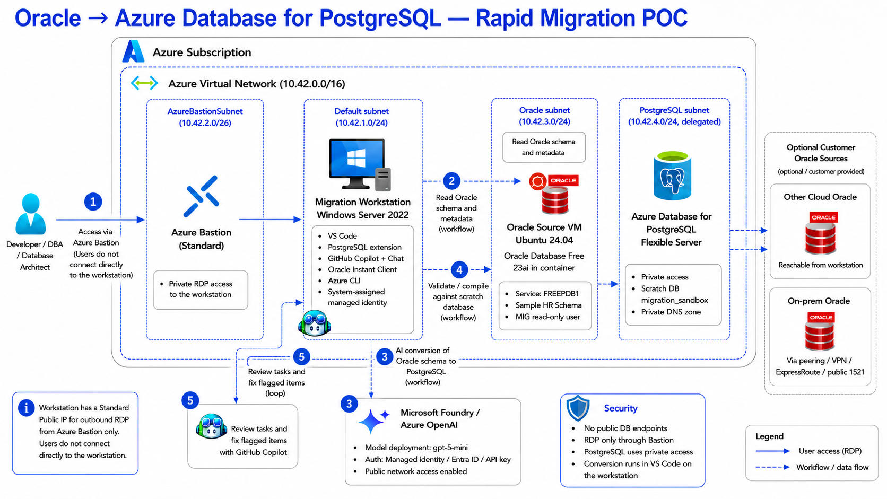](azure/media/schema-conversions-vm-workstation/logical-architecture.png)

The migration workstation runs Visual Studio Code and the PostgreSQL extension inside the
virtual network. Users connect through Azure Bastion; direct inbound RDP is blocked. From the
workstation, the conversion workflow reads Oracle metadata, uses Microsoft Foundry for
AI-assisted conversion, and validates generated objects in the PostgreSQL scratch database.
Customer-provided Oracle sources can replace the sample Oracle VM when the workstation has a
network route to them.

The diagram shows the complete environment. The deployment form can omit the workstation,
sample Oracle source, PostgreSQL target, or AI conversion component; shared networking is
created automatically when a selected component requires it.

## Prerequisites: resource providers

The template uses four Azure resource providers. On an established subscription they are
usually already registered; on a **brand-new subscription** one or more may not be:

| Resource provider | Used for |
|---|---|
| `Microsoft.Compute` | Windows workstation + Oracle source VMs |
| `Microsoft.Network` | VNet, NSG, public IPs, NICs, Bastion, private DNS |
| `Microsoft.DBforPostgreSQL` | Azure Database for PostgreSQL flexible server |
| `Microsoft.CognitiveServices` | Azure OpenAI (Microsoft Foundry) account + deployment |

**Deploying with the button (portal):** the Azure portal registers any missing providers
automatically during validation, so you normally don't have to do anything.

**Deploying from the CLI / PowerShell, or to be safe on a fresh subscription:** register them
first. Each call is idempotent and returns immediately; registration finishes in the
background within a minute or two. You need `Contributor` or `Owner` on the subscription.

```bash
# Azure CLI — register all four (safe to re-run)
for rp in Microsoft.Compute Microsoft.Network Microsoft.DBforPostgreSQL Microsoft.CognitiveServices; do
  az provider register --namespace "$rp"
done

# optional: confirm all four report "Registered" before deploying
for rp in Microsoft.Compute Microsoft.Network Microsoft.DBforPostgreSQL Microsoft.CognitiveServices; do
  printf '%s\t%s\n' "$rp" "$(az provider show --namespace "$rp" --query registrationState -o tsv)"
done
```

```powershell
# PowerShell equivalent
'Microsoft.Compute','Microsoft.Network','Microsoft.DBforPostgreSQL','Microsoft.CognitiveServices' |
  ForEach-Object { Register-AzResourceProvider -ProviderNamespace $_ }
```

If a provider is not registered, the deployment fails with `MissingSubscriptionRegistration`
("The subscription is not registered to use namespace 'Microsoft.X'"). Registering the named
provider and redeploying resolves it.

### Public IP feature flag (first-time subscriptions)

Separately from the providers above, some subscriptions gate public-IP creation behind a
**subscription feature flag** (registered through Azure Feature Exposure Control, `az feature`).
If deployment fails with:

> `... is not registered for feature Microsoft.Network/AllowBringYourOwnPublicIpAddress
> required to carry out the requested operation`

register the feature, wait until it reports **Registered**, then re-register the provider so
the change propagates and redeploy. Unlike resource providers, the portal does **not**
auto-register these feature flags, so this step is manual and can take a few minutes:

```bash
# Azure CLI
az feature register --namespace Microsoft.Network --name AllowBringYourOwnPublicIpAddress

# poll until this prints "Registered"
az feature show --namespace Microsoft.Network --name AllowBringYourOwnPublicIpAddress \
  --query properties.state -o tsv

# propagate the feature to the provider, then redeploy
az provider register --namespace Microsoft.Network
```

```powershell
# PowerShell
Register-AzProviderFeature -FeatureName AllowBringYourOwnPublicIpAddress -ProviderNamespace Microsoft.Network
(Get-AzProviderFeature -FeatureName AllowBringYourOwnPublicIpAddress -ProviderNamespace Microsoft.Network).RegistrationState
Register-AzResourceProvider -ProviderNamespace Microsoft.Network
```

> The flag name is misleading: this template does **not** use BYOIP or custom IP prefixes. It
> only creates ordinary Azure-allocated Standard public IPs (one for Azure Bastion, one for the
> workstation). On some subscriptions Azure gates *all* Standard public IP creation behind this
> flag despite its name, so registering it simply enables ordinary public IPs.

## Deploy to Azure

Click the button, sign in to the Azure portal, fill in the form (admin username and
password), choose **Deploy all components** or select individual components, configure the
visible component settings, and select **Review + create**. Shared networking is added
automatically when required. No CLI is required.

<p>
  <a href="https://portal.azure.com/#blade/Microsoft_Azure_CreateUIDef/CustomDeploymentBlade/uri/https%3A%2F%2Fraw.githubusercontent.com%2FMicrosoftLearning%2Fmslearn-postgresql%2Fmain%2FAllfiles%2FDeploy%2Fazure%2Fazuredeploy.json/createUIDefinitionUri/https%3A%2F%2Fraw.githubusercontent.com%2FMicrosoftLearning%2Fmslearn-postgresql%2Fmain%2FAllfiles%2FDeploy%2Fazure%2FcreateUiDefinition.json"></a>
</p>
<p>
  <a href="http://armviz.io/#/?load=https%3A%2F%2Fraw.githubusercontent.com%2FMicrosoftLearning%2Fmslearn-postgresql%2Fmain%2FAllfiles%2FDeploy%2Fazure%2Fazuredeploy.json"></a>
</p>

Start on **Project details**: select the subscription, create or select a resource group,
choose a supported region, and enter the administrator credentials. Then select **Next** to
choose the components to deploy.

[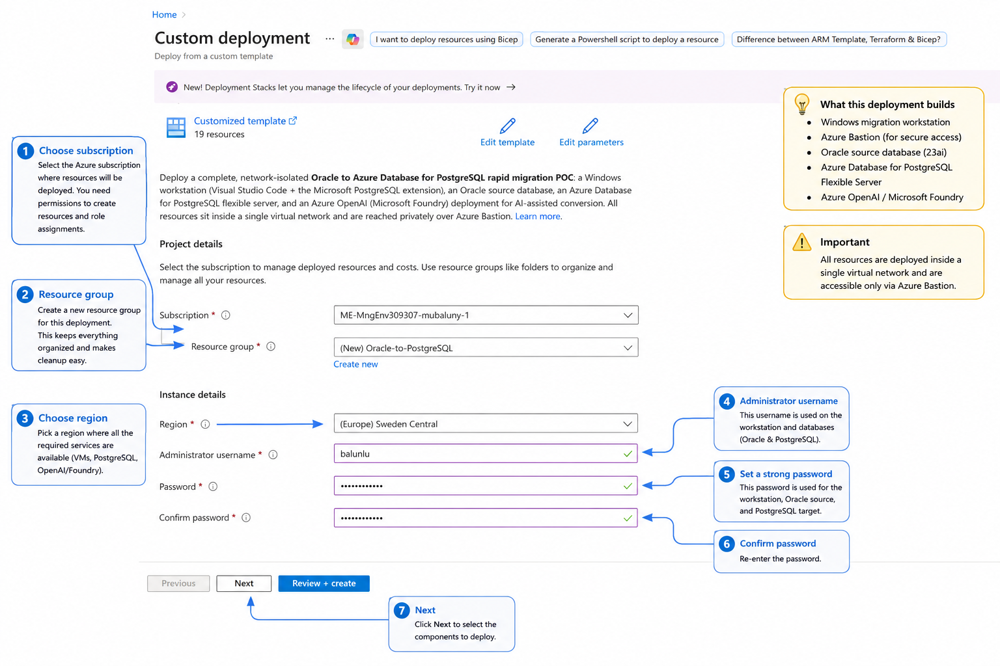](azure/media/deployment-guide/01-configure-project-details.png)

On **Components**, keep **Select all** for the full POC, or clear it and choose one or more
individual components. Then select **Next** to configure your selection.

[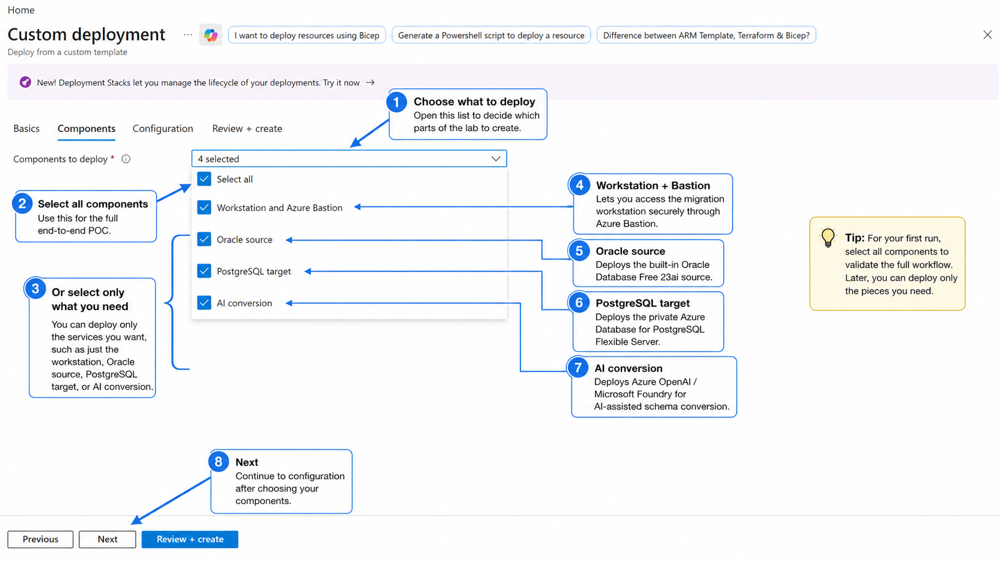](azure/media/deployment-guide/02-select-components.png)

On **Configuration**, review the settings for the selected components. The defaults are
suitable for the rapid POC; adjust VM sizes for quota or availability and change the model
deployment name only when deploying a different model configuration.

After configuration, use **Review + create** to confirm the project details, selected
components, and component settings. When validation succeeds, select **Create**.

[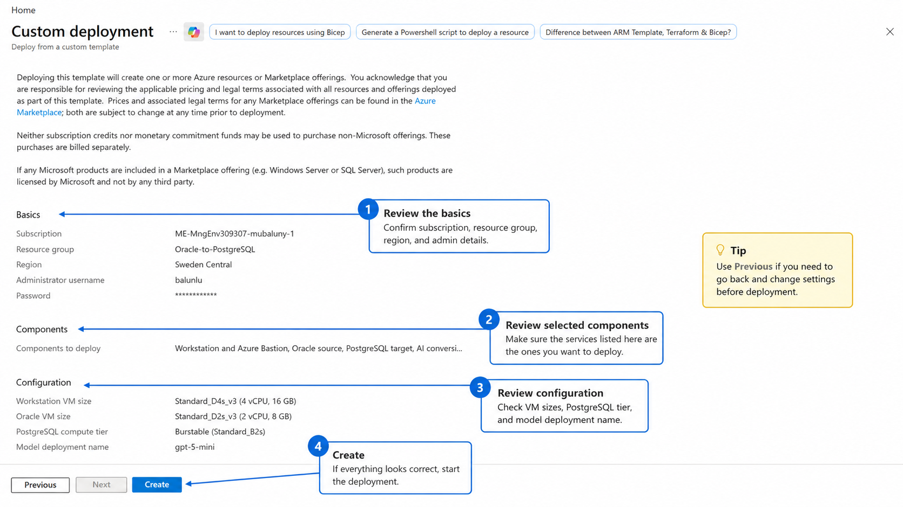](azure/media/deployment-guide/03-review-and-create.png)

After deployment, open the resource group and verify that the resources for your selected
components were created. If you deployed the workstation, open **migration-workstation** next.

[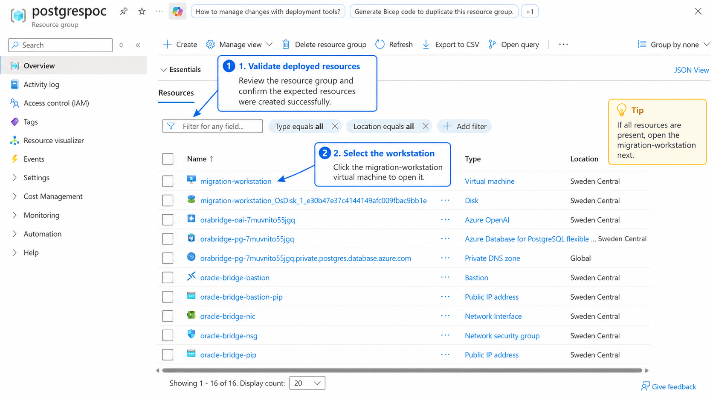](azure/media/deployment-guide/04-validate-deployed-resources.png)

> **If a resource looks unreachable, check it isn't stopped.** Some subscriptions have
> governance or auto-shutdown policies that stop compute to save cost. Before you connect,
> confirm these are **Running** in the portal and start any that were stopped:
> the **PostgreSQL flexible server**, the **migration-workstation** VM, and the
> **oracle-source-vm**.

On the workstation page, select **Connect** > **Connect via Bastion** for browser access. The
deployment blocks direct public RDP; use Bastion or the documented Bastion tunnel instead.

[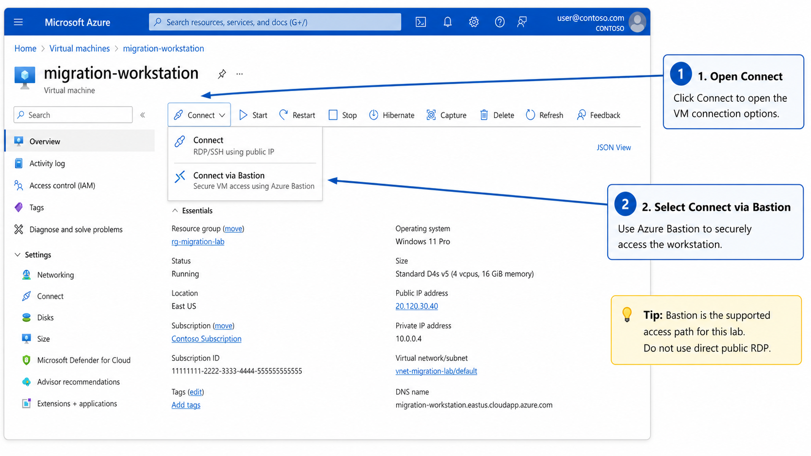](azure/media/deployment-guide/05-connect-via-bastion.png)

## What's installed on the workstation

The workstation is a Windows Server 2022 VM provisioned at deploy time by
[azure/setup.ps1](azure/setup.ps1).

**VS Code extensions** (installed at first interactive logon):

| Extension | ID | Purpose |
|---|---|---|
| PostgreSQL (Microsoft) | `ms-ossdata.vscode-pgsql` | Runs the Migration Wizard and performs the AI schema conversion |
| GitHub Copilot | `github.copilot` | Copilot agent used to triage and fix conversion tasks |
| GitHub Copilot Chat | `github.copilot-chat` | Chat / agent mode for resolving flagged items |

**Command-line tooling** (installed system-wide during deployment):

- **Visual Studio Code** (desktop, added to `PATH`)
- **Oracle Instant Client 21.13** (thick-client mode, on `PATH`) — connects to the Oracle source
- **Azure CLI** — Azure sign-in (`az login`) for working with the deployed resources

> **First-logon note:** the three extensions install via a Windows `RunOnce` entry the first
> time you sign in, so they need outbound access to the VS Code Marketplace at that moment and
> appear a few seconds after the desktop loads. The setup log's `PROVISION_COMPLETE` line is
> written *before* that logon, so it confirms the deploy-time steps finished — not that the
> extensions installed. If any are missing, run the `code --install-extension` commands from
> [azure/setup.ps1](azure/setup.ps1) manually in a terminal.

On first logon, keep the setup command open while it installs the per-user Visual Studio Code
extensions. For browser-based Bastion, allow cookies and pop-ups for the Azure portal.

[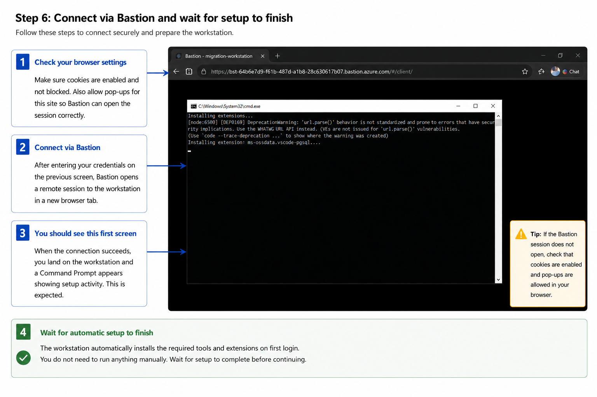](azure/media/deployment-guide/06-complete-workstation-setup.png)

Dismiss the Windows first-logon prompts and close Server Manager pop-ups. Network discovery
isn't required for this workflow, so select **No** unless your organization requires it.

[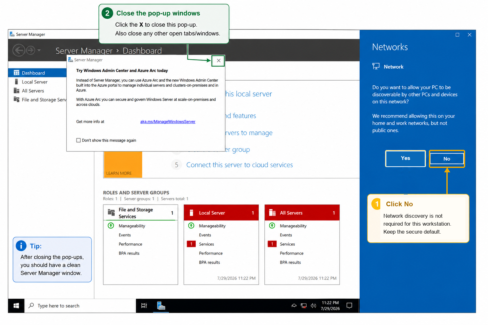](azure/media/deployment-guide/07-dismiss-first-logon-prompts.png)

Open **connection-info.txt** from the public desktop and keep it available for the Migration
Wizard. It contains connection metadata for the selected components, but no passwords, API
keys, or tokens.

[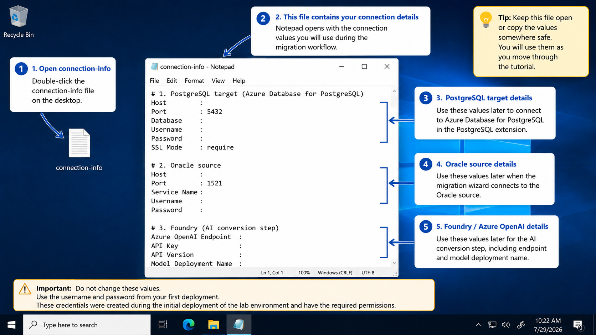](azure/media/deployment-guide/08-review-connection-info.png)

Open the Windows **Start** menu, launch **Visual Studio Code**, and confirm the PostgreSQL
extension is installed before starting the Migration Wizard. If the initial GitHub sign-in
welcome screen appears, close it and authenticate later when the workflow requests it.

[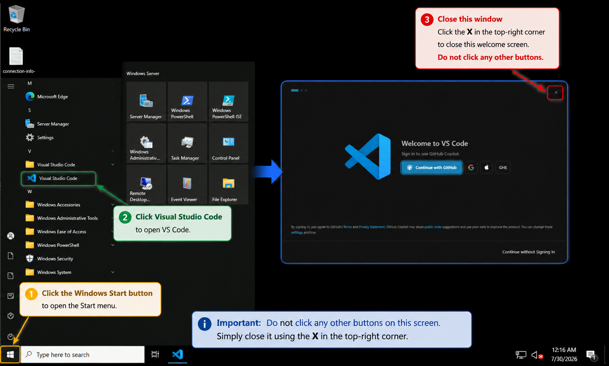](azure/media/deployment-guide/09-open-visual-studio-code.png)

## Run the schema conversion

Start here after the Azure deployment, Bastion connection, and first-logon extension
installation above. **Those infrastructure steps are unchanged.** All conversion steps run
in **Visual Studio Code on the workstation**, where the private database endpoints are
reachable.

This walkthrough follows `Schema_Conversion_Full_Demo.mp4` and these official Microsoft
instructions:

- [Convert Oracle schemas to Azure Database for PostgreSQL](https://learn.microsoft.com/en-us/azure/postgresql/migrate/oracle-conversions-schema/schema-conversions-tutorial).
- [Oracle migration in the PostgreSQL extension](https://learn.microsoft.com/en-us/azure/postgresql/development/vs-code-extension/oracle-migration).
- [Set up a converted Oracle schema](https://learn.microsoft.com/en-us/azure/postgresql/migrate/oracle-conversions-schema/schema-conversions-setup).
- [Review converted objects in Conversion Object Explorer](https://learn.microsoft.com/en-us/azure/postgresql/migrate/oracle-conversions-schema/schema-conversions-object-explorer).

Button names can vary: the tutorial uses **Migrate**, while the recording shows **Start
conversion**. Follow the equivalent action in your installed extension; the recording doesn't
establish an exact extension version. The extension workflow is interactive, not a headless
conversion command.

> **Compatibility check — the POC model defaults need attention.** The current Microsoft
> tutorial requires a **Microsoft Foundry `gpt-5.2` deployment with more than 1,000,000 tokens
> per minute (TPM) quota**. This repository's unchanged infrastructure defaults are
> **`gpt-5-mini` and 10,000 TPM**, which **don't meet that requirement**. Before conversion,
> arrange a supported model deployment and sufficient quota with your Azure administrator.
> Use that deployment's actual endpoint and deployment name in the wizard. Don't assume
> the model recorded in `connection-info.txt` or `FOUNDRY_DEPLOYMENT` satisfies the current
> tutorial. These Microsoft Learn requirements were checked on **November 2, 2026**.
> Check the linked prerequisites again before running: requirements and model
> availability can change.

### 1. Check the tools, accounts, and connection values

1. On the workstation, open **Start** > **Visual Studio Code**.
2. Select **Extensions** in the left activity bar. Confirm **PostgreSQL**, published by
   Microsoft, is installed and enabled. Confirm GitHub Copilot is available for the
   AI-assisted review steps. Wait for the first-logon installation to finish if necessary.
3. Check **Help** > **About**: the tutorial requires Visual Studio Code **1.95.2 or later**.
   The PostgreSQL scratch server must be **15 or later**; this POC defaults to PostgreSQL 16.
4. For Copilot-assisted review, use an account with **GitHub Copilot Pro+, Business, or
   Enterprise**. Sign in when prompted. Authentication alone doesn't resolve conversion
   problems.
5. If you plan to use Microsoft Entra ID for Foundry, install the **Azure Account**
   extension and confirm the account has the current tutorial's required access, including
   **Foundry User** (formerly Azure AI User). The POC template grants **Cognitive Services
   OpenAI User** on its own OpenAI resource; don't assume that grant applies to a different
   resource or satisfies every current Foundry requirement.
6. Open **connection-info.txt** on the public desktop. Keep it beside VS Code. For the
   database connections, use the actual values from this file or the deployment outputs:

| Value | Where to use it | Built-in POC value or source |
|---|---|---|
| `postgresFqdn` | PostgreSQL server/host | Complete server name ending in `.postgres.database.azure.com` |
| `postgresAdmin` | PostgreSQL username | Administrator chosen during deployment; not necessarily `azureuser` |
| `postgresDatabase` | Disposable scratch database | `migration_sandbox` unless overridden at deployment |
| PostgreSQL port and SSL | PostgreSQL connection | Port `5432`, SSL mode `require` |
| `oraclePrivateIp` | Oracle host | Private IP of the built-in Oracle VM |
| `oracleServiceName` | Oracle service name | `FREEPDB1` for the built-in source |
| Oracle port and username | Oracle connection | Port `1521`, user `MIG` |
| Deployment password | Built-in Oracle and PostgreSQL connections | Password you supplied during Azure deployment; not stored in connection-info.txt |
| Supported Foundry endpoint and deployment name | AI model configuration | Values for the supported deployment arranged above, not automatically the POC defaults |

Confirm the workstation can reach Oracle, PostgreSQL, and the selected Foundry endpoint.
The extension uses Oracle **thin client mode by default**. Oracle Instant Client, already
installed on this workstation, is needed only when your Oracle environment requires thick
mode. For your own Oracle, also review [Use your own Oracle source](#use-your-own-oracle-source)
and the official source-metadata prerequisites. Schema conversion reads metadata and
definitions, not table rows; row-data access isn't required for conversion. The built-in
`MIG` account has broader POC grants.

**Checkpoint:** VS Code and the PostgreSQL extension are ready, the required accounts and
supported model deployment are available, and you know which values belong to each connection.

Screenshots below are real frames from the supplied schema-conversion demo, not captures
of a run against this POC. Connection details are redacted where needed. Select a screenshot
to view it at full resolution; captions identify its video timestamp.

> **Demo values aren't lab requirements.** The video's additional schemas, connection names,
> database names, and object counts belong to its environment. This POC seeds a much smaller
> HR sample. Don't copy private hostnames, passwords, API keys, or the video's dependency
> schema names into your own configuration.

### 2. Connect PostgreSQL, open a workspace, and create the project

1. Select the **PostgreSQL** elephant icon in the VS Code activity bar.
2. Under **Connections**, select **Add Connection**. If your connection already exists,
   open it and verify its server and database rather than adding a duplicate.
3. On **Connect to PostgreSQL Server**, use **Parameters** and fill in the fields:

   | Field | Value for this POC |
   |---|---|
   | **Server Name** | The actual `postgresFqdn` output, not the Oracle VM address |
   | **Authentication Type** | **Password**, for the administrator provisioned by this POC |
   | **User Name** | The actual `postgresAdmin` value |
   | **Password** | The password entered during Azure deployment |
   | **Database Name** | The actual `postgresDatabase` value, normally `migration_sandbox` |
   | **Connection Name** | A recognizable local profile name, for example `POC PostgreSQL` |

4. Open **Advanced** to confirm port **5432** and SSL mode **require**. Return to the main
   form. Clear **Save Password** on a shared or long-lived workstation.
5. Select **Test Connection**. Correct any reported error before continuing.
6. Select **Save & Connect**. Expand the saved server under **Connections**, then expand
   **Databases** to confirm the intended scratch database is present.
7. Select **File** > **Open Folder**. Create and select a writable folder on the
   workstation, for example `Desktop\SchemaConversionPOC`, and select **Select Folder**.
   If VS Code asks about workspace trust, trust only this folder that you created and
   control. This is the workspace for generated SQL, reports, and deployment scripts;
   it is not the Azure resource group or the database name.
8. Return to the PostgreSQL extension and expand **Migrations**. Select
   **+ Create Migration Project**. If the view is missing, open **Settings**, search for
   `pgsql.enableMigrations`, and confirm it is enabled.
9. On **New Oracle to Azure Database for PostgreSQL migration project**, enter a
   **Project Name**, for example `HRSchemaPOC`. Select **Next: Oracle Connection**.
10. On **Connect to Oracle**, fill in the separate source connection:

    | Field | Value for the built-in Oracle source |
    |---|---|
    | **Oracle Hostname** | `oraclePrivateIp` from the deployment outputs |
    | **Oracle Port** | `1521` |
    | **Oracle SID or Service Name** | `oracleServiceName`, normally `FREEPDB1` |
    | **Oracle Username** | `MIG` |
    | **Oracle Password** | The password entered during Azure deployment |

11. Select **Load Schemas** and wait for the connection to succeed.
12. Open **Schemas**, select **HR**, and close the dropdown. For your own source, select
    the application schemas you intend to convert instead.
13. Select **Next: Discovery**.

**Checkpoint:** the Oracle connection succeeds and the selected source schemas appear in
Discovery. A successful PostgreSQL connection doesn't establish that Oracle is reachable;
these are separate connections.


[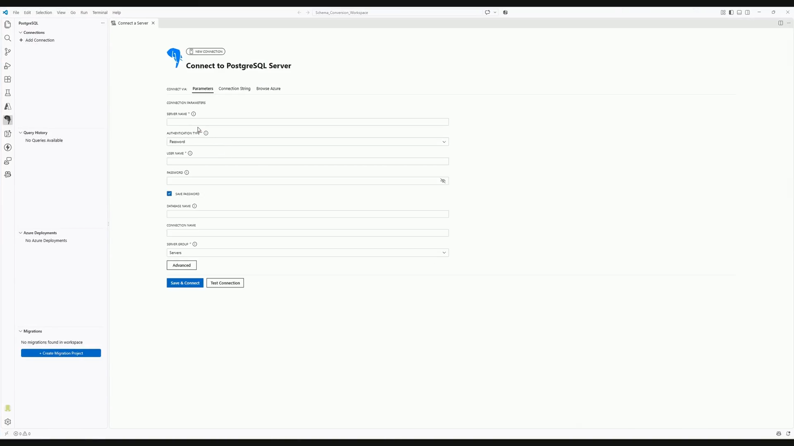](azure/media/extension-walkthrough/01-postgresql-connection.png)

*Video frame 0:32: Connect to PostgreSQL Server with Parameters, Advanced, Test Connection, and Save & Connect.*

[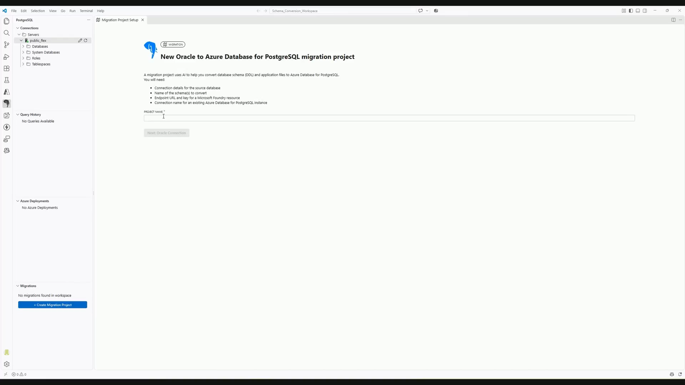](azure/media/extension-walkthrough/02-project-setup.png)

*Video frame 0:41: Create the migration project by entering Project Name and selecting Next: Oracle Connection.*

[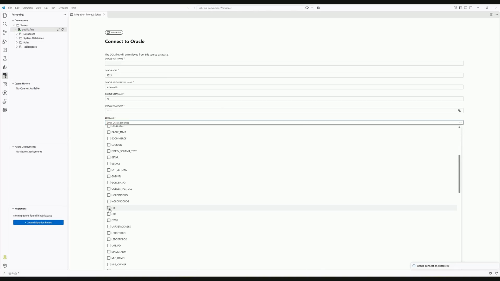](azure/media/extension-walkthrough/03-oracle-connection.png)

*Video frame 1:00: Load Oracle schemas and select HR. Use FREEPDB1 and MIG for this POC, not the video service/user values.*

### 3. Complete Discovery and acknowledge scope

Discovery runs **before extraction and conversion**. It checks permissions, object coverage,
and dependencies.

1. Wait for Discovery to finish. No source DDL has been extracted at this stage.
2. Under **Source permissions**, read each result. The video shows five checks covering
   connection/session access, `SELECT_CATALOG_ROLE`, `SELECT ANY DICTIONARY`,
   `SYS.ARGUMENT$`, and `V$RESOURCE_LIMIT`. If a check fails, ask the Oracle administrator
   to review the [required source privileges](https://learn.microsoft.com/en-us/azure/postgresql/migrate/oracle-conversions-schema/schema-conversions-tutorial#source-oracle-privileges);
   do not grant broad privileges simply to make the screen green.
3. Review the four inventory categories: **Discovered**, **To be extracted**,
   **Excluded**, and **Invalid objects**. These describe discovery and planned extraction,
   not how many objects have converted successfully.
4. Expand **Supported object types**. Read the extraction, exclusion, and invalid-object
   counts for each type. Supported does not mean every object will convert without work.
5. Expand **Not supported object types** if shown. Record any functionality that will need
   a PostgreSQL alternative or separate remediation.
6. Under **Dependent schemas**, inspect references to application schemas you did not
   select. Select **Show diagram**, review the relationships, then select **Close**.
   Diagram edge numbers count dependency references, not objects to migrate. Referenced
   Oracle system schemas are not additional application schemas selected for migration.
7. If the source selection needs to change, select **Previous**, update **Schemas** on
   **Connect to Oracle**, and select **Next: Discovery** again. Listing a dependency
   does not itself select it for conversion.
8. After an administrator changes source grants, select **Refresh Discovery** and inspect
   the results again.
9. Select **I have reviewed the objects, exclusions and dependent schemas**.
10. Select **Next: PostgreSQL Connection**.

In the recording, Discovery identifies a `GOLDEN_PG_FULL` dependency. That is an example of
what to inspect, **not** a schema to add to the built-in HR POC. Its inventory of 338 objects
and 247 to extract isn't a conversion outcome or an expected count for this repository.

**Checkpoint:** Discovery has no unresolved blockers, and you understand the conversion scope
and dependencies rather than just accepting a green status.


[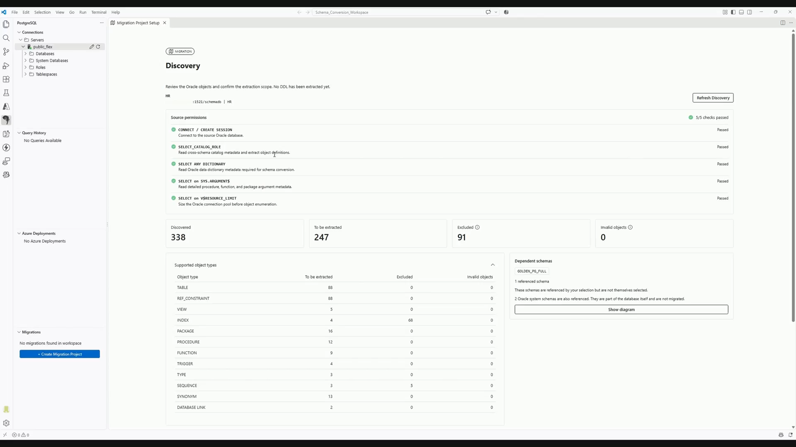](azure/media/extension-walkthrough/04-discovery.png)

*Video frame 1:20: Discovery source-permission checks, inventory categories, supported object types, and dependent schemas.*

[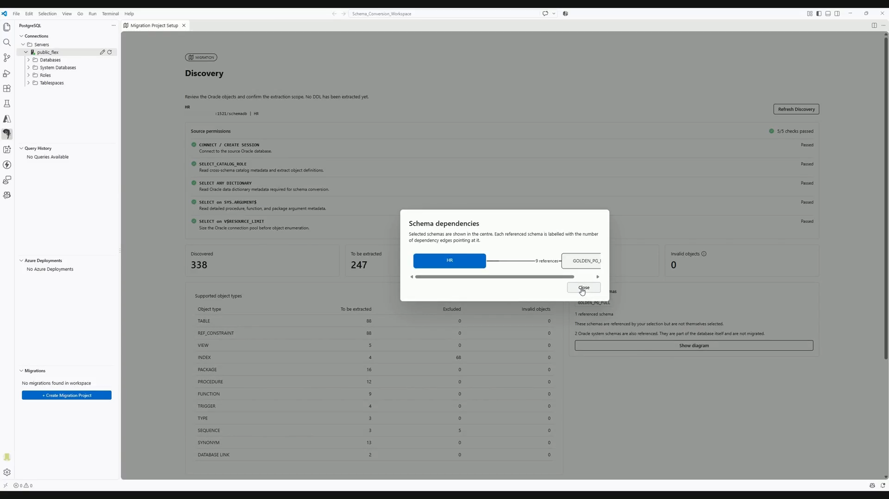](azure/media/extension-walkthrough/05-dependency-diagram.png)

*Video frame 1:41: Discovery dependency diagram. GOLDEN_PG_FULL is a video-only example, not a required POC schema.*

### 4. Configure a disposable scratch database

The scratch database is where the extension attempts to compile generated PostgreSQL
objects. It isn't the final deployment destination.

> **Read before acknowledging: scratch preparation is destructive.** Matching schemas in
> the selected scratch database can be dropped with **`DROP ... CASCADE`** and recreated,
> removing their data and dependent objects. Use a disposable database without application
> or shared data. Never choose an existing production database as scratch.

1. On **Choose an Azure Database for PostgreSQL scratch database**, open
   **PostgreSQL Connection** and select the profile you saved in Step 2. This page reuses
   that profile; it is not another Oracle connection form.
2. If the profile is missing, select **Refresh Profiles**. If it still does not appear,
   return to **Connections** and create or correct the profile before continuing.
3. Open **PostgreSQL Database** and choose the actual `postgresDatabase`, normally
   **`migration_sandbox`**. Select **Load Databases** if the list is empty.
   Use your configured name if you changed the deployment parameter, not the video's
   `demodb` example.
4. Select **Verify Extensions**. This checks extension availability; it **does not install
   extensions**.
5. If extensions are missing, have the PostgreSQL administrator allow-list required extensions
   in `azure.extensions` and install them in the scratch database. Complete any required
   preload configuration or restart, then retry verification. The POC attempts extension
   installation on the optional Oracle VM, but that can be skipped or fail; it doesn't
   automatically create `pg_cron`. Follow the
   [scratch-database preparation guidance](https://learn.microsoft.com/en-us/azure/postgresql/migrate/oracle-conversions-schema/schema-conversions-best-practices#prepare-the-scratch-database).
   Some recommended-extension warnings permit continuation, but objects using a missing
   extension can still need changes. Do not treat a dismissible warning as readiness.
6. Confirm the selected server, database, and affected schemas again.
7. Read and select the acknowledgment that matching schemas are dropped and recreated
   and their existing objects and data deleted. Accept only if the scope is disposable.
8. Select **Next: Microsoft Foundry Model Configuration**.

**Checkpoint:** required extensions are ready and you knowingly accepted the scratch reset
scope. Azure deployment completion alone isn't proof of either condition.


[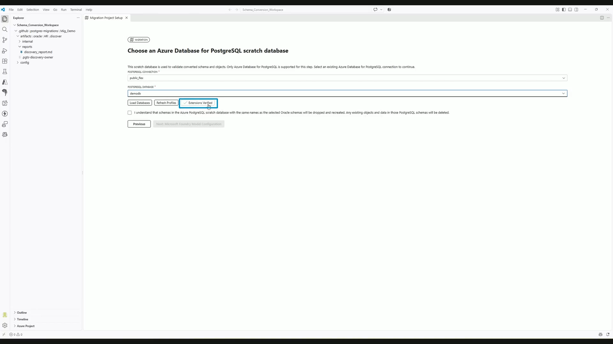](azure/media/extension-walkthrough/06-scratch-database.png)

*Video frame 2:17: Scratch database selection, Extensions Verified, and the destructive schema-reset acknowledgment.*

### 5. Configure and test Microsoft Foundry

1. On **Choose a Microsoft Foundry Model**, select **gpt-5.2** in **Model Name**, as
   required by the current Microsoft tutorial.
2. Obtain the supported deployment's actual endpoint, deployment name, and authorized
   authentication details from its owner or administrator. In Microsoft Foundry, verify
   the deployment details and allocated TPM quota before starting.
3. Enter **Microsoft Foundry Endpoint** using the resource URL documented for that
   deployment. Do not paste the Azure portal page address or copy the video's endpoint.
4. Enter **Deployment Name** using the name assigned to the deployed model. This name
   need not match `gpt-5.2` or the Azure resource name.
5. Choose an allowed **Authentication Method**:
   - **API key:** use a key from the selected resource if your organization permits local
     authentication. The video demonstrates this method. Keep the key out of source files,
     logs, screenshots, and reports.
   - **Microsoft Entra ID:** sign in with the Azure Account extension using an account
     authorized for the selected Foundry resource. Confirm the documented roles rather
     than assuming a subscription or workstation sign-in provides inference access.
6. If the portal says API-key authentication is disabled by the resource owner, don't try
   to bypass that policy. Use Entra ID with the appropriate role assignments.
7. Select **Test Microsoft Foundry Connection**. Wait for a successful result.
   Resolve authentication, quota, endpoint, or model errors before proceeding.
8. Select **Create Migration Project**.

The model receives source definitions and metadata, not table rows. Review organizational
policies before using a customer source even though no row data is migrated.

**Checkpoint:** the model connection test succeeds and the project is created.


[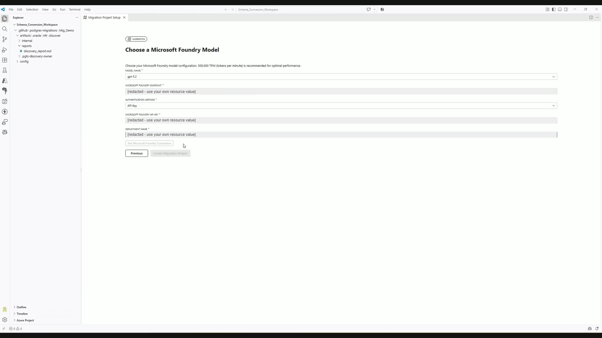](azure/media/extension-walkthrough/07-foundry-configuration.png)

*Video frame 2:29: Foundry model, authentication, deployment, and connection-test controls. Resource values are redacted; the video UI recommendation is 500,000 TPM, but follow the current Microsoft Learn requirement above of more than 1,000,000 TPM.*

### 6. Run conversion and read the results

1. In the project's schema-conversion view, select **Migrate**, or **Start conversion** as
   shown in the video.
2. Watch extraction, PostgreSQL definition generation, and compile attempts in scratch.
   Keep VS Code and its connections available until the operation completes.
3. When **Schema conversion is complete** appears, select **Review conversion summary**.
   The HTML conversion report can also open automatically.
4. On **Conversion summary**, inspect counts and results by object type. Select
   **Conversion report** to open or reopen the HTML report.
5. In the report, expand the discovery, extraction, and conversion sections and inspect
   object-level notes and unsuccessful results. Keep discovery inventory,
   extracted objects, conversion entries, and deployed objects separate: their totals can
   differ because they describe different phases and scopes.
6. Return to **Conversion summary** to open **Conversion object explorer** or
   **Setup instruction**. The first opens detailed review; the second opens generated
   deployment documentation, **not deployment**.

> **Interpret the recording carefully.** At 3:28 it shows **241 converted, 9 not converted,
> 96.4%**. The denominator is 250 conversion entries: 247 extracted objects plus 3 schema
> entries. Those aren't expected outcomes for this POC. Conversion status describes
> conversion/compile coverage, not behavioral correctness or production readiness. The video
> fast-forwards processing, so its duration isn't a performance benchmark.

**Checkpoint:** the summary is available, and you have identified outstanding issues rather
than treating completion as acceptance.


[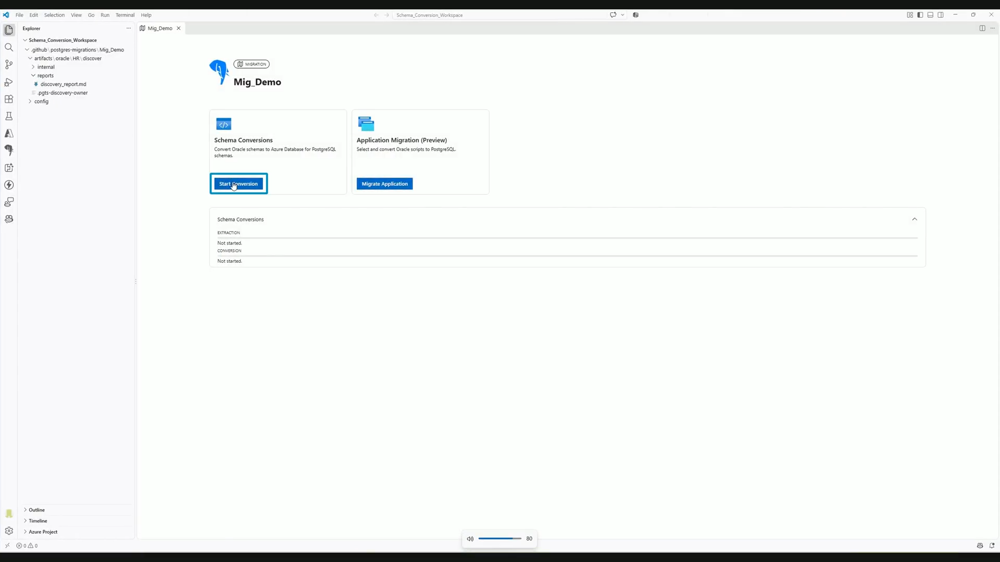](azure/media/extension-walkthrough/08-start-conversion.png)

*Video frame 2:43: Start conversion on the Schema Conversions card; application migration is a separate workflow.*

[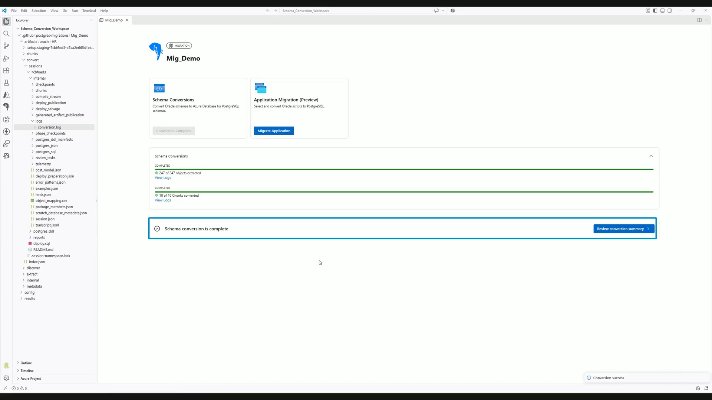](azure/media/extension-walkthrough/09-conversion-progress.png)

*Video frame 3:24: Separate extraction and conversion completion indicators with Review conversion summary.*

[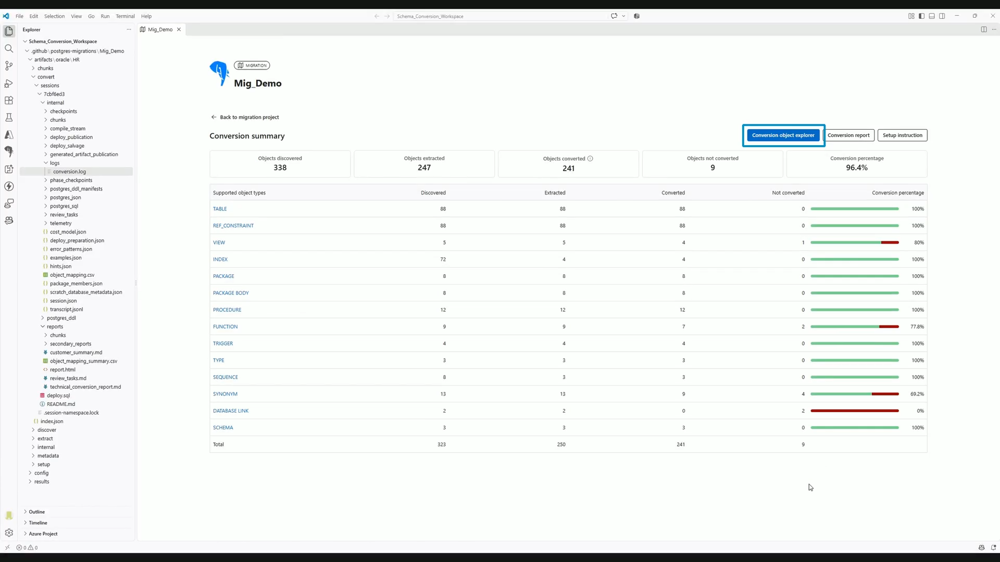](azure/media/extension-walkthrough/10-conversion-summary.png)

*Video frame 4:08: Conversion summary with object-type results and the Object Explorer, Conversion report, and Setup instruction actions.*

[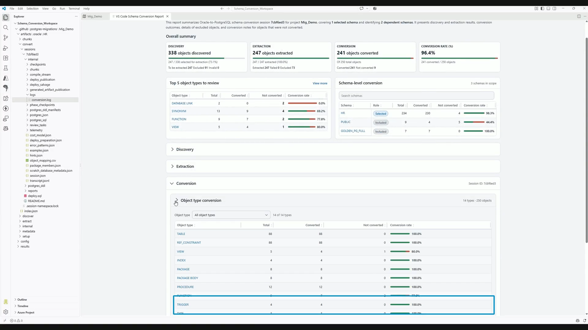](azure/media/extension-walkthrough/11-conversion-report.png)

*Video frame 3:37: HTML report separates discovery, extraction, conversion counts, and schema/object-type results.*

### 7. Inspect mappings and review Copilot-assisted fixes

1. Open **Conversion Object Explorer**. Use **Filter by source object name**,
   **All schemas**, **All source object types**, and **All statuses** to find an object.
   Read **Schema**, **Source type**, and **Source object** together, then compare
   **Target object**, **Target type**, and **Status**. Use the page controls below the table
   if there are more results.
2. Open the object's diff: **Oracle on the left, PostgreSQL on the right**. Read the
   **Conversion notes** panel and warnings, even for an object marked converted.
3. Review the SQL and notes now. If a separate nonproduction database has not yet been
   deployed, **do not execute the object yet**: complete Steps 8-10 first. You can still
   use **Ask** and review **Fix** edits before deploying.
4. When a nonproduction database is ready for compilation checks, select the database icon
   for **CONNECT PGSQL TARGET** and choose the intended server profile. The icon then
   becomes **CHANGE PGSQL target database**; use it to choose that database, not scratch or
   the `postgres` maintenance database. Confirm the active connection and database in the
   bottom-right status bar.
5. Check schema qualifiers in the SQL. Changing the selected database doesn't change the
   schema names in the statements.
6. For interactive checks, select complete PostgreSQL statements before executing.
   **With no selection, the action can execute the entire editor.** Inspect the selected
   statements and their effects first.
7. If a relation is missing, verify the active database, required dependencies, target
   mapping, and deployment order before changing SQL. In the demo, `public.customers`
   requires investigation rather than blindly creating another table.
8. Select **Ask** to send the object's SQL, conversion notes, and error context to Copilot.
   Sign in with your licensed GitHub account when prompted. **Fix** can edit the converted
   SQL; inspect its changes before accepting and testing them.
9. Review the proposed change against the Oracle definition and intended PostgreSQL
   mapping before accepting it. Save accepted edits with **Ctrl+S**.
10. Inspect the consolidated deployment SQL and ensure it contains every accepted change.
   Saving a per-object file, applying SQL to a database, and updating `deploy.sql` are
   **three separate actions**; none proves the other two happened.

For packages or other expandable multi-statement objects, select the parent's chevron,
then select each member to inspect its mapping, SQL, and conversion notes. A package can
produce multiple PostgreSQL statements; reviewing its parent alone does not review them all.
The object-type filter inside an expanded package filters its members by **Oracle source
type**, while **All source object types** above the main table filters top-level objects.
Use expand-all or collapse-all at the explorer or package level to manage the hierarchy.

The recording changes `public` qualifiers to `golden_pg_full`. That illustrates a schema
mapping correction; it isn't a required target schema for this POC. Inspect your generated
SQL instead of assuming Oracle HR must map to PostgreSQL `public`.

> **Don't rerun conversion to rebuild deployment SQL.** The current tutorial says a completed
> schema conversion **can't be rerun**. Keep the reviewed per-object definitions and
> consolidated deployment SQL aligned, and preserve your project/session artifacts. Don't
> rely on an automatic regeneration step to retain manual fixes.

**Checkpoint:** mappings and outstanding issues have been reviewed, accepted edits are saved,
and deployment SQL matches the reviewed object definitions. If no destination exists yet,
compilation and behavioral validation are still pending. The video's Copilot repair summary
explicitly says database compilation was not performed; editing a file is not proof of a
successful database repair.


[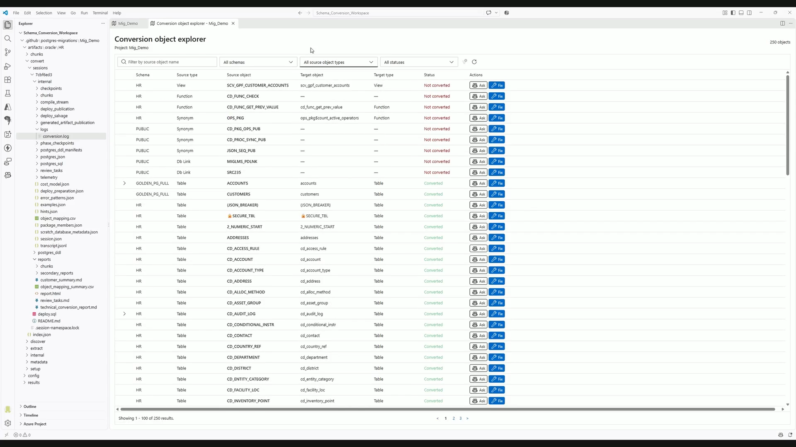](azure/media/extension-walkthrough/12-object-explorer.png)

*Video frame 4:42: Conversion Object Explorer filters, source-to-target mappings, statuses, and Ask/Fix actions.*

[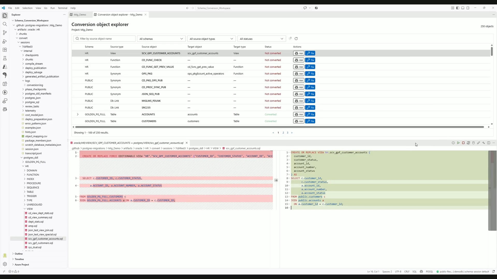](azure/media/extension-walkthrough/13-object-comparison.png)

*Video frame 5:18: Oracle source on the left and generated PostgreSQL on the right, with editor execution controls.*

[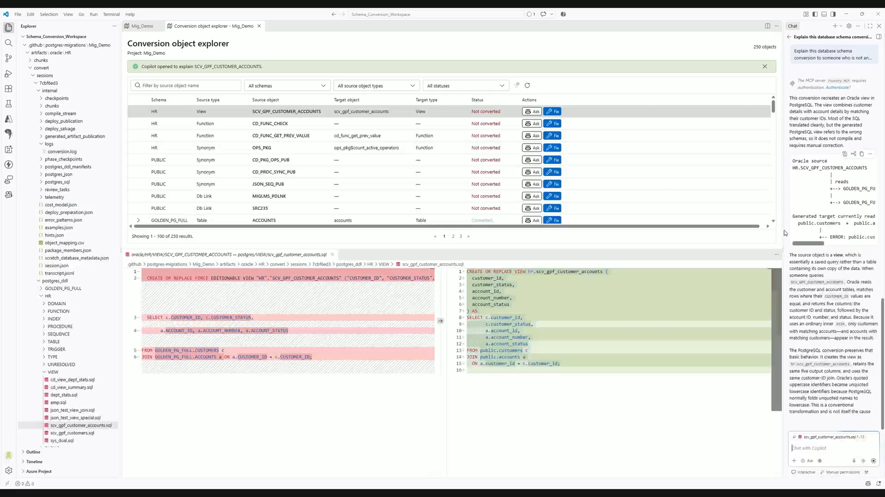](azure/media/extension-walkthrough/14-copilot-ask.png)

*Video frame 6:05: Ask opens a Copilot explanation using the selected object, its SQL, and conversion context.*

[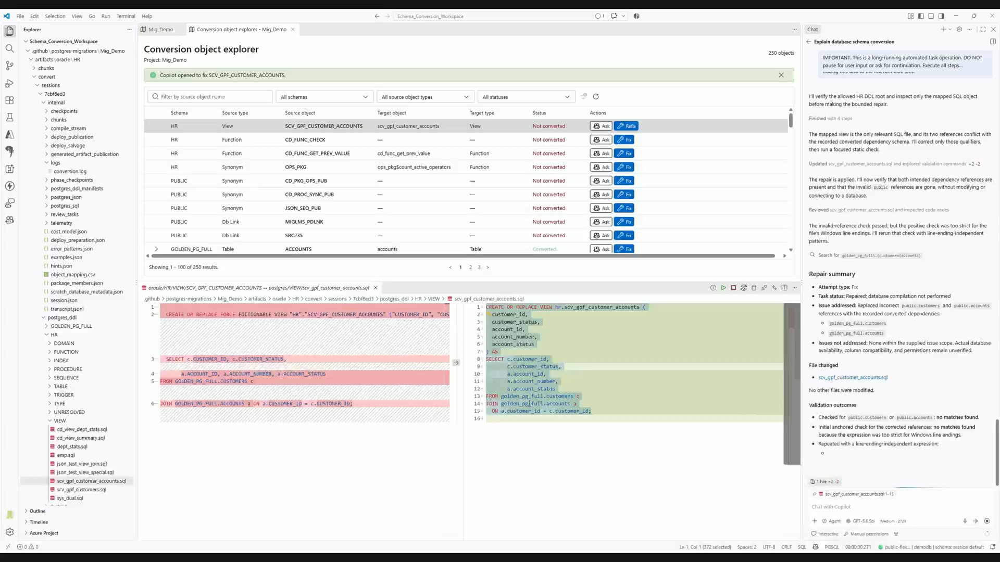](azure/media/extension-walkthrough/15-copilot-fix.png)

*Video frame 6:30: Reviewed Copilot schema-qualifier correction. The repair summary states that database compilation was not performed.*

### 8. Locate the generated deployment package

1. Return to the conversion summary and open **Setup Instruction**.
2. In VS Code Explorer, locate the generated setup directory under your project:

   | Source selection | Generated directory |
   |---|---|
   | One selected Oracle schema, such as HR | `.github\postgres-migrations\<project>\artifacts\oracle\<schema>\setup` |
   | Multiple selected Oracle schemas | `.github\postgres-migrations\<project>\artifacts\oracle\_migration\setup` |

   The number of selected **Oracle** schemas determines this path, not how many dependent or
   target PostgreSQL schemas appear later.
3. Open **`setup_instructions.md`** in that directory. The package includes **`setup.ps1`**,
   **`setup.sh`**, **`sql`**, **`reports`**, and **`logs`**. Keep the **full project** and
   relative layout: the runners also use the neighboring conversion session's deployment SQL.
   Don't copy only a runner to another folder.
4. Follow the package's client and permission prerequisites. On this Windows workstation,
   use **PowerShell 5.1 or later** and install a PostgreSQL **`psql` client whose major
   version matches the conversion-server major version recorded in the package**. Don't
   assume the Oracle Instant Client or VS Code extension supplies `psql`.
5. If `psql` is not installed, open the official
   [PostgreSQL Windows downloads page](https://www.postgresql.org/download/windows/).
   Follow the approved installer or distribution for the required major version.
   If the installer offers component selection, install the **Command Line Tools**;
   this task does not require another local PostgreSQL server. Follow your organization's
   software-installation policy.
6. Ensure the client `bin` directory is on **PATH**, for example
   `C:\Program Files\PostgreSQL\<major-version>\bin`. If you change PATH in Windows
   Environment Variables, reopen VS Code and its terminal so they receive the change.
   Do not copy the video's PostgreSQL 18 requirement over this POC's PostgreSQL 16
   configuration: use the version recorded by **your** generated package.
7. In a terminal, check the selected client:

   ```powershell
   psql --version
   ```

8. In VS Code Explorer, right-click the generated **setup** folder and choose **Open in
   Integrated Terminal**. Use a PowerShell terminal. The commands in the next step must run
   **from this generated setup folder**, not the repository's `Allfiles\Deploy\azure`
   folder. That folder also contains a `setup.ps1`, but it provisions the workstation and
   is **not** the generated schema-deployment runner.

**Checkpoint:** the generated package remains intact, the correct client is available, and
the terminal is in the generated setup folder.


[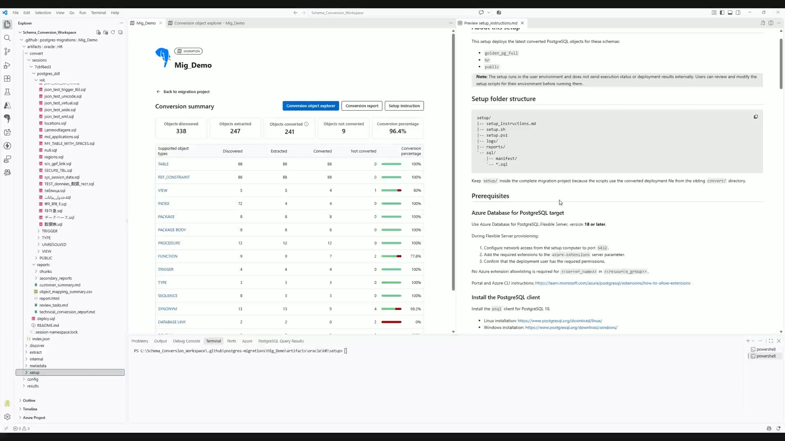](azure/media/extension-walkthrough/16-setup-instructions.png)

*Video frame 6:45: Setup instruction opens generated package layout and prerequisites without deploying. PostgreSQL 18 is the video package example; use the version in your generated POC package.*

### 9. Choose the destination and validate

The Azure PostgreSQL **server already exists**. The generated runner deploys a schema into
a database on that server; it doesn't provision another Azure server.

1. Choose one database mode:
   - **New database:** use a separate, unused nonproduction database name. The runner creates
     that database during deployment; the connecting account must have permission to do so.
   - **Existing database:** inspect its schemas, data, and dependents before proceeding.
     Review populated-schema handling and back up anything you need to preserve. Don't
     choose the scratch database as the final deployment destination.
2. For the built-in POC, you can use the existing server's `postgresFqdn` and `postgresAdmin`
   for the destination connection, provided the generated package's requirements are met.
   Choose a **different, unused database name**, for example `hr_converted_test`.
   Do not enter `migration_sandbox` when following the recommended new-database path.
3. For a first check, run the matching **validate-only** command from the generated setup
   folder:

   ```powershell
   # Validate new-database mode (the default).
   .\setup.ps1 -ValidateOnly

   # OR validate an existing nonproduction database.
   .\setup.ps1 -DatabaseMode existing -ValidateOnly
   ```

4. Answer prompts for missing host, username, and database using your intended destination.
   Enter the password only at the hidden password prompt. The example database name in
   a prompt's brackets is a default, not an instruction to reuse the scratch database.
5. Review the displayed destination, mode, schemas, and validation operation before
   confirming. This check is not deployment.
6. Open the generated **reports** folder and read `validation_report_<timestamp>.md`;
   read any console errors and available logs if the run stopped before writing a report.
7. Resolve blocking findings and review warnings before proceeding.
   In **new-database mode**, validation connects and writes local outputs but **doesn't
   create the database, install extensions, or deploy objects**. Destination-only checks
   that can't run are **skipped**, not passed.

The video explains validate-only but doesn't execute it. Use the generated instructions for
your own validation; don't treat the recording as a passed validation run.

For Linux or another Bash environment, the documented equivalents are:

```bash
# Validate new-database mode.
bash setup.sh --validate-only

# OR validate existing-database mode.
bash setup.sh --database-mode existing --validate-only
```

**Checkpoint:** you have reviewed the destination, selected mode, validation results, and
skipped checks. Required blockers are resolved before deployment.

### 10. Deploy and interpret every output

> **Confirm the destination before continuing.** Deployment changes the selected database.
> Existing-database mode can affect populated schemas and requires acknowledgment. The
> documented automation acknowledgments, `-AllowNonEmptyExisting` and
> `--allow-nonempty-existing`, aren't harmless defaults; don't add them just to silence
> a warning. Read the generated instructions and understand the scope first.

1. From the same generated setup folder, run **one** command for the intended mode:

   ```powershell
   # Deploy into a new nonproduction database (default mode).
   .\setup.ps1

   # OR deploy into the reviewed existing nonproduction database.
   .\setup.ps1 -DatabaseMode existing
   ```

   Bash equivalents:

   ```bash
   bash setup.sh
   # OR:
   bash setup.sh --database-mode existing
   ```

2. Enter missing connection values at the prompts. Check the final confirmation's
   **destination, database mode, schema scope, and operation** before approving deployment.
3. The runner prepares the database, checks readiness/extensions, executes deployment SQL,
   and verifies objects. Watch for reported failures rather than just waiting for it to stop.
4. Read the generated outputs:

   | Output | What to inspect |
   |---|---|
   | `reports\validation_report_<timestamp>.md` | Validate-only findings and skipped checks |
   | `reports\deployment_report_<timestamp>.md` | Deployment outcome and outstanding items |
   | `reports\verification_<timestamp>.csv` | Per-object verification |
   | `reports\extensions_<timestamp>.csv` | Extension readiness and deployment results |
   | `reports\preflight_<timestamp>.csv` | Preflight/readiness results |
   | `logs\setup_<timestamp>.log` | Detailed execution context and errors |

5. Inspect the process exit code. In PowerShell, check `$LASTEXITCODE` immediately after
   the runner; in Bash, check `$?` immediately after the command. Continue only on **0**
   for the requested operation.

   | Exit code | Meaning |
   |---|---|
   | `0` | Requested operation succeeded; validate-only success is still **not deployment** |
   | `1` | Input/client problem or cancellation |
   | `2` | Package/configuration/connection/database/readiness/extension problem |
   | `3` | Deployment/verification/reporting or unexpected failure |
   | `4` | Objects or extensions weren't deployed |

6. Refresh the PostgreSQL explorer and inspect objects under the **actual generated
   target schemas** in the intended destination database. Compare with the report; object
   visibility by itself doesn't establish correctness.
7. Resolve outstanding items, reconcile reviewed SQL, and independently validate behavior
   before accepting the result.

> **Don't assume a failed run changed nothing.** New-database mode creates the database
> before some later checks. A failed operation can leave a newly created database or partial
> SQL changes. Inspect the destination, report, and logs before retrying. Don't blindly rerun
> destructive SQL or use `DROP SCHEMA ... CASCADE` as a generic undo operation.

> **The recorded deployment is incomplete.** At 8:20, the demo reports **245 deployed,
> 17 not deployed, exit code 4**. The 17 comprise **16 not included and 1 not found**,
> **not 17 failed SQL statements**. Those are illustrative counts, not expected POC output
> or a successful acceptance criterion.

This remains a **schema-only** workflow: it doesn't migrate table rows. Plan data movement
separately, and validate data handling and application behavior independently of conversion
and deployment coverage. If executing SQL manually, first select the intended server and
database; don't accidentally use the `postgres` maintenance database.

**Checkpoint:** deployment reports and exit status have been reviewed, outstanding issues
are resolved, the expected objects are in the intended database, and independent validation
is complete before any production use.


[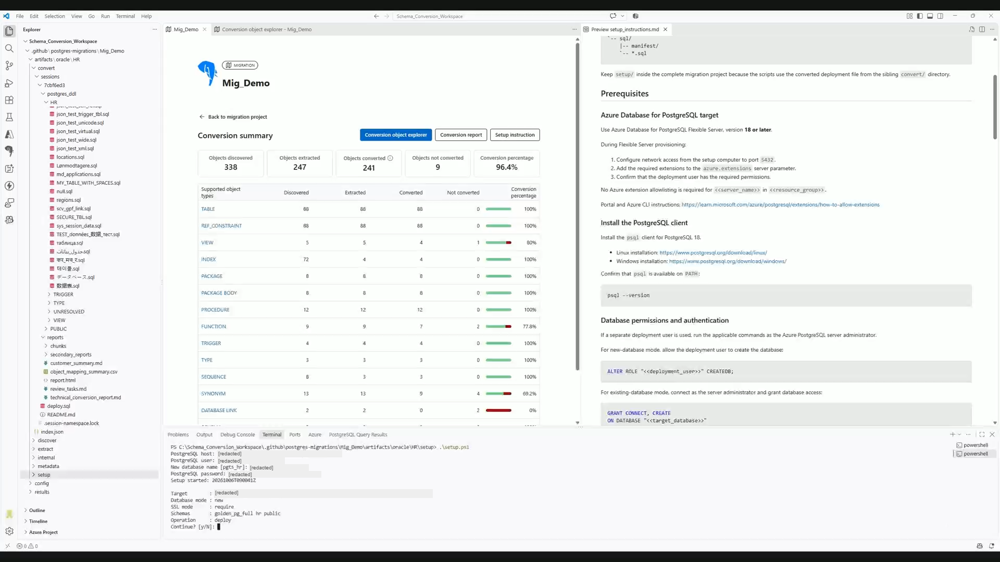](azure/media/extension-walkthrough/17-deployment-command.png)

*Video frame 7:50: Generated PowerShell runner prompts and final confirmation: database mode, TLS, schema scope, and operation. Connection values are redacted.*

[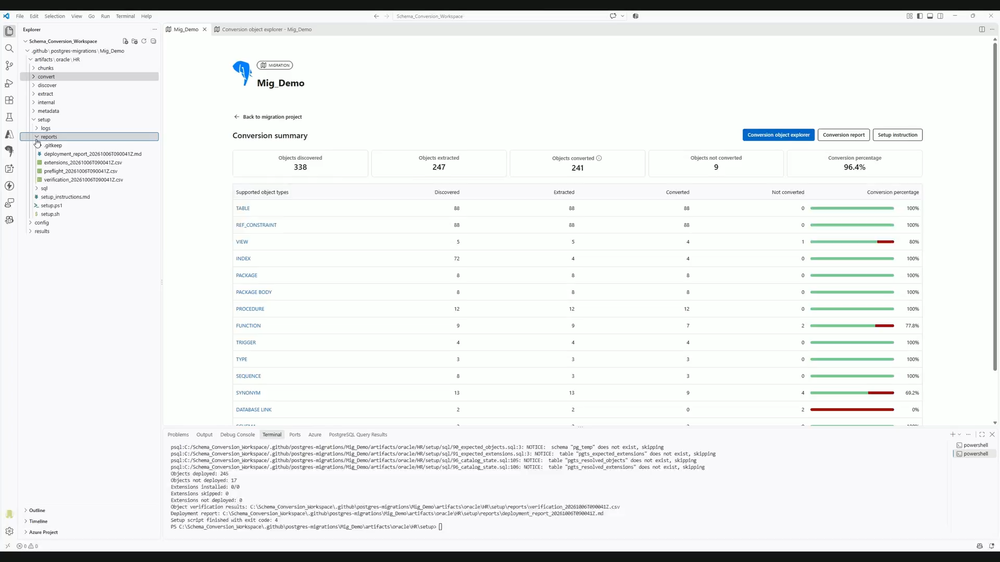](azure/media/extension-walkthrough/18-deployment-results.png)

*Video frame 8:25: Deployment console reports 245 deployed, 17 not deployed, and exit code 4. This is an incomplete demo deployment.*

[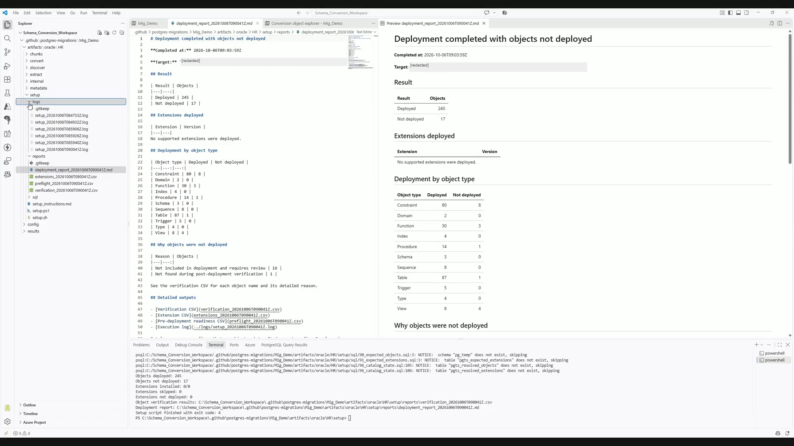](azure/media/extension-walkthrough/19-deployment-report.png)

*Video frame 8:37: Deployment report and verification outputs show remaining items, including 16 not included and one not found. Destination connection is redacted.*

### 11. Validate the schema in the separate nonproduction database

Conversion and deployment status do not establish that the generated SQL behaves like
Oracle. Use representative test data and application calls for validation; this POC does
not move that data for you.

1. In the PostgreSQL extension, expand the saved server, **Databases**, and the destination
   database you deployed, such as `hr_converted_test`.
2. Refresh the database tree and expand **Schemas**. Inspect the actual target schemas in
   your generated mapping; do not assume HR was mapped to `public`.
3. Compare tables, views, functions, procedures, constraints, and other objects with
   `deployment_report_<timestamp>.md` and `verification_<timestamp>.csv`. For the built-in
   source, the five seeded tables are `REGIONS`, `COUNTRIES`, `LOCATIONS`, `DEPARTMENTS`,
   and `EMPLOYEES`; inspect their **mapped** PostgreSQL names rather than expecting the
   video's larger inventory.
4. For corrections, return to **Conversion object explorer**, open the relevant object,
   and confirm the SQL editor's active **server and destination database**.
5. Select the complete PostgreSQL statements you intend to run, then select the SQL editor's
   **play** button or run **Execute PostgreSQL Query**. Without a selection the entire editor
   can run. Review the execution result; do not treat a file save or Copilot message as
   database execution.
6. Reconcile the tested correction in the per-object SQL and `deploy.sql` so the next
   deployment includes it. Do not rerun the completed conversion as a regeneration step.
7. In the disposable validation environment, compare representative Oracle and PostgreSQL
   result sets, constraints, dependencies, numeric/date behavior, transaction behavior,
   and error handling. Retest after each correction and include objects that originally
   failed, not only those marked **Converted**.
8. Record and resolve remaining conversion or deployment issues before acceptance. Keep
   row-data migration and application-code changes as separate work.
9. Revoke temporary setup privileges when no longer needed, and use the existing
   [tear-down instructions](#tear-down) to remove disposable POC resources when finished.

**Checkpoint:** representative behavior has been independently validated in the destination
and outstanding objects have been resolved. Empty converted tables and a green conversion
status alone are not production-readiness evidence.

### Troubleshooting the extension workflow

| Symptom | Action |
|---|---|
| Migrations view is missing | Confirm the Microsoft PostgreSQL extension is enabled and `pgsql.enableMigrations` is enabled. Check the current tutorial's prerequisites. |
| PostgreSQL connection times out | Confirm the flexible server and workstation are **Running**, then check the complete hostname, private DNS, routing, and firewall rules. Connect from the workstation; the POC database has no public endpoint. A timeout alone doesn't identify the cause. |
| Discovery or Load Schemas fails on `SYS.ARGUMENT$` | Verify source metadata permissions. Built-in `MIG` receives `SELECT ANY DICTIONARY`; for a customer source, have the Oracle administrator review the current tutorial's grants rather than blindly broadening access. Refresh Discovery after changes. |
| Verify Extensions fails | Confirm both the server allow-list and database installation, plus required preload/restart settings. Verification doesn't install extensions. |
| Foundry connection or inference fails | Check supported model, quota, actual endpoint/deployment name, authentication policy, and role assignments. The unchanged POC's model/quota defaults don't meet the current tutorial requirement. |
| `psql` isn't recognized, or the client check fails | Install the client required by the generated package, ensure its binary directory is on PATH, reopen the terminal if needed, and run `psql --version`. Match the recorded conversion-server major version. |
| A converted object references a missing relation | Confirm active database, source dependencies, generated schema qualifiers, and deployment order before using Copilot to change SQL. |
| Runner can't locate SQL/package files | Restore the full generated project's relative layout and run from its generated setup folder. Don't use `Allfiles\Deploy\azure\setup.ps1`. |
| PowerShell refuses to run the generated script | Read the exact policy or signing error and use your organization's approved execution/signing process. Do not disable workstation security controls just to run the POC. |
| Deployment exits nonzero or reports missing/not-included objects | Read per-object classifications, reports, and logs; inspect partial database effects; fix the relevant blocker and reconcile SQL before retrying. Don't equate not-deployed counts with executed SQL failures. |

## Use your own Oracle source

The built-in `oracle-source-vm` exists so you can prove the end-to-end flow with zero external
dependencies. Once that run succeeds, you can point the Migration Wizard at your own
**dev/test** Oracle instead — nothing on the workstation changes (the Oracle Instant Client is
already installed). Before you connect, make sure the following are in place.

> **Recommended:** run the POC once against the built-in Oracle source first. It validates the
> workstation, Bastion access, the PostgreSQL target, and your Azure OpenAI quota — so if
> anything is off, you know it isn't your own database or network.

**1. Network path (workstation → your Oracle on port 1521)**

The `migration-workstation` must be able to reach your Oracle listener on **1521**. Choose one:

- **VNet peering** — peer this deployment's VNet with the VNet hosting your Oracle.
- **Site-to-site VPN or ExpressRoute** — for an on-premises Oracle.
- **Public endpoint** — the workstation has outbound internet, so your Oracle's firewall/NSG can
  instead allow inbound 1521 from the workstation's public IP (`publicFqdn`). Least preferred;
  only for non-sensitive dev/test.

**2. A read-only migration login**

Create a login for the wizard with the same privileges the built-in `MIG` user gets:

```sql
CREATE USER MIG IDENTIFIED BY "<strong-password>";
GRANT CREATE SESSION        TO MIG;
GRANT SELECT ANY DICTIONARY TO MIG;   -- covers SYS.ARGUMENT$ etc. the wizard reads
GRANT SELECT_CATALOG_ROLE    TO MIG;
GRANT SELECT ANY TABLE       TO MIG;   -- or grant SELECT only on the schemas you convert
```

The conversion **only reads** the source — it never writes to your Oracle — so it is safe to run
against dev/test.

**3. The correct connect identifier**

Use the **service name** of the pluggable database (PDB) you want to convert — not the CDB root
— along with the host and port 1521. A wrong service name is the most common connection failure.

**4. TLS/wallet (only if your Oracle enforces TCPS)**

The default path assumes plain TCP on 1521. If your Oracle requires encrypted connections
(TCPS), supply the wallet/certificate to the Oracle Instant Client on the workstation.

Everything else in the workflow above is identical — just enter your Oracle's host, port, service
name, and the migration-user credentials at the **Connect to Oracle** step.

## Tear down

When you're done, remove everything by deleting the resource group. Azure has no native
one-click *delete* URL (by design), so this button opens the **Resource groups** blade in
the portal — pick the POC's resource group (for example `oracle-bridge-rg`) and choose
**Delete resource group**:

[](https://portal.azure.com/#browse/resourcegroups)

Or run the teardown script (deletes the group and purges the soft-deleted Azure OpenAI
account so its name is freed):

```bash
./azure/teardown.sh oracle-bridge-rg
```

Equivalent one-liner:

```bash
az group delete -n oracle-bridge-rg --yes
```

## What's in this repo

| Path | Purpose |
|---|---|
| [azure/azuredeploy.json](azure/azuredeploy.json) | Compiled ARM template behind the **Deploy to Azure** button |
| [azure/createUiDefinition.json](azure/createUiDefinition.json) | Portal form definition for the one-click deployment |
| [azure/main.bicep](azure/main.bicep) | Bicep source — provisions the whole POC environment: VNet/NSG/Bastion, the Windows workstation, the Oracle source VM, the PostgreSQL flexible server, and the Azure OpenAI deployment |
| [azure/setup.ps1](azure/setup.ps1) | PowerShell run by an Azure Run Command — installs VS Code + PostgreSQL extension + Oracle Instant Client + Azure CLI on the workstation |
| [azure/teardown.sh](azure/teardown.sh) | Deletes the resource group and purges the soft-deleted Azure OpenAI account |
| [azure/cloud-init.yaml](azure/cloud-init.yaml) | Cloud-init for the **Oracle source VM** — installs Docker, runs Oracle Database Free 23ai, and seeds the sample HR schema on first boot |

## Deploy from the command line (optional)

If you prefer the CLI over the portal button:

```bash
az group create -n oracle-bridge-rg -l westeurope

az deployment group create -g oracle-bridge-rg -f azure/main.bicep \
  -p adminUsername=azureuser \
     adminPassword='<strong-password>'
```

The admin username and password are reused for the workstation RDP login and for the
Oracle and PostgreSQL admin accounts. The template also creates an Azure OpenAI model
deployment (default `gpt-5-mini`) and grants the workstation's managed identity the
**Cognitive Services OpenAI User** role — so the deploying identity needs permission to
create role assignments (**Owner** or **User Access Administrator** on the resource group).

> If the deployment fails preflight with a `QuotaExceeded` error for a VM family, your
> subscription has no quota for that size in the region. Run `az vm list-usage -l <region>`
> and pass a size you do have, for example `-p vmSize=Standard_D4s_v3` (workstation) or
> `-p oracleVmSize=Standard_D2s_v3` (Oracle source). If the OpenAI deployment fails with
> a model-deprecation error, pass a currently available model, for example
> `-p openAiModelName=gpt-5-mini openAiModelVersion=2025-08-07`.

The deployment outputs `publicFqdn`, `vmResourceId`, `bastionRdpTunnelCommand`,
`oraclePrivateIp`, `oracleServiceName`, `postgresFqdn`, `postgresAdmin`, `foundryEndpoint`,
and `foundryDeployment`. Access is **RDP only, via an Azure Bastion tunnel** — no SSH, no
public RDP port, no public web ports. Open the tunnel, RDP to `localhost:13389` with the
password you set, then use VS Code. Reset the password later via `az vm run-command`.

## Security

- RDP only, via an Azure Bastion tunnel — no SSH, no public RDP port; RDP (3389) is reachable only from the virtual network.
- The Oracle source (1521) and the PostgreSQL flexible server are reachable **only from within the virtual network** — no public database endpoints. PostgreSQL uses private access with a private DNS zone.
- No public web ports.
- The login password is a `@secure()` deploy-time parameter (not stored in the template) and can be rotated with `az vm run-command`. It is reused for the Oracle and PostgreSQL admin accounts for POC convenience — change them for anything beyond a POC.
- The workstation uses a system-assigned managed identity, granted only the **Cognitive Services OpenAI User** role on the lab's Azure OpenAI account.
- Independently validate all converted objects before deploying to production.

## Contributors

_The following people contributed to this project._

Principal author:

- [Lukman Balunywa](https://www.linkedin.com/in/lukman-balunywa-a68620118) | Principal Solution Engineer, Cloud/AI Platforms

Other contributors:

- Naren Narendra | Principal Group Program Manager, R&D Data – SQL DB
- [Vijayalakshmi Somasundaram](https://www.linkedin.com/in/sviji/) | Principal Solution Engineer, Cloud/AI Platforms
- [Huan Lee](https://www.linkedin.com/in/huanlee) | Principal Solution Engineer, Cloud/AI Platforms
- [Jarrett Long](https://www.linkedin.com/in/jarrettlong) | Principal Solution Engineer, Cloud/AI Platforms
- [Jamail Abelhad](https://www.linkedin.com/in/jamailabelhad) | Senior Solution Engineer, Cloud/AI Platforms

_To see nonpublic LinkedIn profiles, sign in to LinkedIn._
